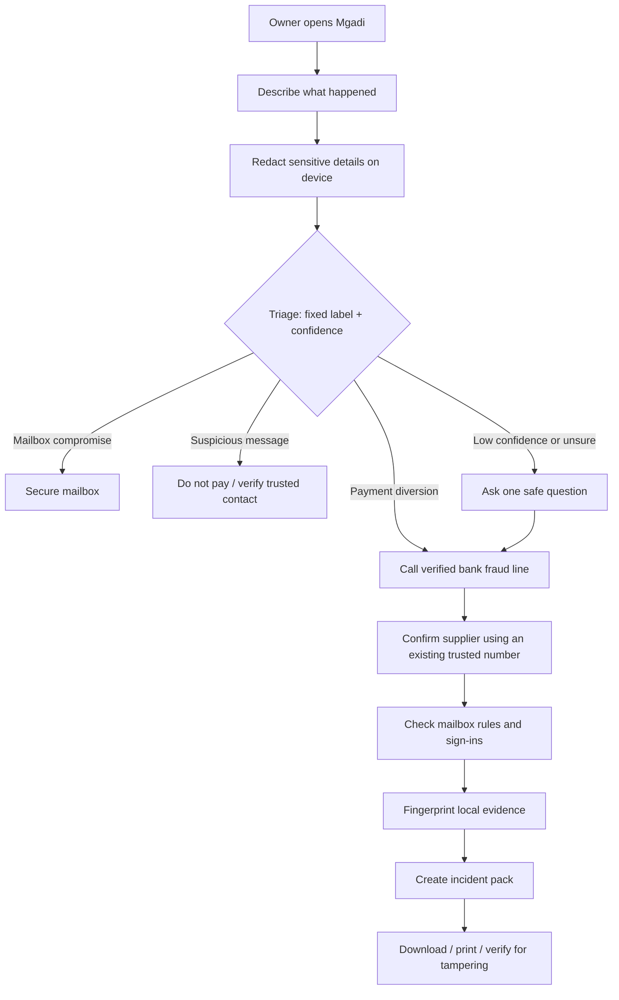
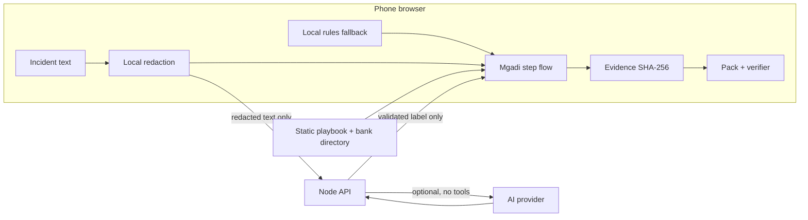

# Mgadi — Source of Truth

**Status:** active build document
**Last updated:** 2026-10-27 11:32 SAST (UTC+02:00)
**Owners:** Chuma (product, security, server, pitch) and Dalindyebo (mobile experience, browser features, integration)
**Audience:** team members and any AI agent working in this repository

> Read this file before changing code, product scope, dependencies, data or deployment. Update the change log at the bottom in the same work session whenever a material decision or code change is made.

---

## 1. What we are building

**Mgadi** is a no-install, phone-first web app for a South African small-business owner during the **first hour after a suspected payment-diversion scam**.

A common scenario: a criminal uses a fake invoice or compromised email to say that a supplier's banking details changed. The owner pays the new account, then discovers the real supplier did not receive the money. Mgadi gives the owner reviewed, calm, time-sensitive steps—not improvised AI advice.

### Product promise

> “When a supplier's banking details may have been changed and money has moved, Mgadi gets a small business to the safest first action quickly, protects their privacy, and helps preserve a usable incident record.”

### The narrow MVP

The primary incident is **payment diversion / business email compromise**. We support a few nearby classifications only to safely route someone who does not use technical words:

| Label | Meaning | Where it goes |
|---|---|---|
| `payment_diversion` | Money moved after changed banking details, a fake invoice, or similar deception | Emergency response playbook |
| `mailbox_compromise` | A business email account may be accessed by someone else | Mailbox protection steps |
| `suspicious_message` | Suspicious request, but no money moved yet | Stop-and-verify steps |
| `not_cyber` | Ordinary payment/admin problem | Cautious double-check guidance |
| `unsure` | Not enough reliable detail | Bank-first caution route; interactive clarification is still to build |

### Explicitly out of scope for this MVP

- Accounts, logins, subscriptions and cloud evidence storage.
- WhatsApp integrations, mailbox monitoring or automatic email access.
- Sending an AI to negotiate with a bank, supplier or criminal.
- Legal determinations, fraud investigations or guarantees of recovery.
- Handling real bank credentials, OTPs, passwords, PINs or card numbers.
- Unrequested automated calls. User-requested calls to the person reporting are now approved product scope; provider setup, consent handling and deployment remain implementation work (see §8 and §11).

---

## 2. Full user flow



### Payment-diversion journey in detail

1. Owner opens Mgadi—no login, no installation.
2. Owner describes the incident and may provide names to hide.
3. Browser redacts names, links, emails, amounts, phone numbers and long account-like numbers.
4. Mgadi classifies only the redacted text into the fixed label list. A local rules fallback works if AI, internet or the server fails.
5. The **bank fraud-line action is always visible first**. The owner chooses a bank and uses an official `tel:` link; Mgadi never calls a number copied from the scam.
6. Owner confirms the supplier by calling a pre-existing trusted number—not by replying to the suspicious message.
7. Owner checks mailbox rules, forwarding and unfamiliar sign-ins.
8. Owner selects evidence files; their SHA-256 fingerprints are made locally. Evidence file contents are not uploaded.
9. Mgadi creates a downloadable, printable incident pack containing timeline and evidence fingerprints. Bank reference and structured outcomes are approved additions, not implemented fields yet.
10. A verifier can show whether a later copy of the pack was changed.

---

## 3. Feature inventory and status

| Feature | Status | Files / notes |
|---|---|---|
| Mobile incident form | Built | `public/index.html`, `public/app.js`, `public/styles.css` |
| Local redaction | Built | `public/shared/redact.js`; browser then server redaction |
| Fixed-label rules triage | Built | `public/shared/labels.js`, `public/shared/rules.js` |
| Protected triage API | Built | `server/app.js` |
| Optional AI adapter | Built, disabled unless key provided | `server/ai.js`; requires `.env.local` |
| Rules fallback | Built | Used for AI outage and demo without API access |
| Bank directory and tap-to-call | Built | `public/data/fraud-lines.json`; phone-check before judging |
| Guided response screens | Built | `public/data/playbook.json`, `public/app.js` |
| Local evidence fingerprinting | Built for HTTPS/localhost | `public/shared/sha256.js`; see known limitation below |
| Incident pack / JSON download / print | Built | `public/shared/pack.js`, `public/app.js` |
| Tamper verifier | Built | `public/shared/pack.js`, `public/app.js` |
| Scoreboard | Built | `scripts/scoreboard.js` |
| Real AI evaluation score | Not done | Needs API key and fresh held-out cases |
| Full phone evidence test | Not done | Needs HTTPS because Web Crypto is restricted on HTTP LAN addresses |
| Practitioner review of playbook | Not done | Ask Track 3 mentor; keep draft badge until done |
| Timed user test / demo video | Not done | Recruit 3–5 people; record results honestly |
| Real phone callback to reporter | Approved scope; not implemented | Retell AI is the assumed candidate from Chuma's reply; South African routing/account setup unverified. See `VOICE-CALLS.md` |
| Vercel HTTPS deployment / PWA offline reopen | Vercel adapters/config prepared and locally tested; cloud deployment blocked by network access. PWA not implemented | `api/`, `vercel.json`, `DEPLOYMENT.txt`; service worker/manifest/icons and actual HTTPS checks remain pending |
| Elapsed time / outcomes / bank reference | Approved; not implemented | Existing timestamps cannot establish faster help or recovery |
| Redaction preview / readable pack / privacy demo view | Approved; not implemented | See §11 and `REVIEW-AND-TEST-CHECKLIST.md` |
| Language choice / translated interview / accessible assistance | Approved; not implemented | All requested text languages are a coverage goal; release per reviewed language. SASL needs distinct content |
| Default referrals / preferred contacts / task tracking | Approved; not implemented | No registration prerequisite; referral is not accepted dispatch |

### Known limitations to say plainly

1. The current pack is a **checksum**, not a digital signature. It detects accidental or unsophisticated edits; a determined editor can change content and calculate a new checksum.
2. SHA-256 browser fingerprinting works on `localhost` and HTTPS. A phone visiting `http://<laptop-ip>:3000` may not have Web Crypto. Deploy HTTPS or add a tested pure-JavaScript fallback before claiming full phone evidence support.
3. Fraud-line entries were checked online on 2026-10-26; phone-check them before a live demo.
4. Playbook wording is a draft until a practitioner reviews it.
5. AI triage is optional and must be tested against a fresh held-out set; never claim performance not measured by the team.
6. Local rules run when an API request fails, but there is no service worker for offline reopening and no request timeout yet. Do not call this fully offline-ready.
7. Bank-directory Back currently returns home rather than resuming the step. Fix before measuring completion times.
8. Redaction is pattern based; names are hidden only when supplied in the optional names field. It is not guaranteed anonymisation. The pack contains the original description and optional business details; add a clear sharing preview.
9. The draft review note exists in the playbook data but is not rendered in the UI. Add a visible status; do not describe the guide as practitioner-reviewed yet.

---

## 4. Architecture



### Storage model

| Location | What may exist | What must not exist |
|---|---|---|
| Browser session | Incident state, timeline, redacted text, fingerprints and generated pack | Uploaded evidence files after the owner closes the tab; credentials |
| Node server memory | Rate-limit counters and temporary hash-keyed triage cache | Raw incident logs, analytics, evidence files, secrets in output |
| AI provider, if enabled | Redacted incident text for one classification | Raw evidence, names, accounts, passwords, phone numbers, invented advice |
| Git repository | Code, synthetic test data, reviewed public guidance | API keys, real victim data, recordings, real call numbers beyond public official support lines |

---

## 5. MUST NEVER CHANGE without explicit team agreement

These are the product's safety invariants. An AI or developer must not remove, weaken or bypass them to make a demo quicker.

1. **The bank action is immediate.** A clearly visible bank-fraud-line option exists from the first screen and never waits for AI, network or a server response.
2. **No credential collection.** Mgadi never asks for a password, OTP, PIN, card number, full bank account login, remote access or app installation.
3. **No attacker-controlled numbers or links.** Official bank actions come only from reviewed local data, never from a pasted incident. Chuma has approved separate manually entered preferred supplier/IT/insurer contacts: label them user-provided, ask the owner to confirm they were independently known before the incident, and never let them replace the official bank directory or become automatic AI dial targets.
4. **Redact before AI.** Only redacted incident text can be sent to the API or an AI provider. Evidence files never go to AI.
5. **AI cannot invent response advice.** Triage AI returns only validated `{ label, confidence }`. Approved voice guidance may read reviewed steps and ask constrained interview questions; it must not improvise instructions, invent contacts, collect credentials or mark real-world tasks complete without confirmation. Validate action events separately from triage.
6. **Fallback must remain.** If AI, API, Wi-Fi, quota or provider fails, the local rules route must still work.
7. **No unsafe HTML.** User-provided text must be displayed with DOM text nodes / `textContent`; never inject it using `innerHTML`.
8. **Evidence stays local.** File bytes must not be uploaded to Mgadi's server or provider for the MVP.
9. **Be honest about hashing.** A match means “unchanged since captured on this device”; it does not prove a file or pack is genuine.
10. **Use synthetic data only.** Do not test with real victims, real inboxes, real bank systems or private business files without clear authorisation.
11. **No secrets in Git.** API keys exist only in ignored `.env.local` files and must never appear in commits, issues, logs or screenshots.
12. **Do not claim legal advice.** POPIA and reporting content remains informational and tells the user to seek qualified help.
13. **Callbacks are user-requested.** Chuma chose real calls to the person reporting. Each call needs the user's affirmative request, an authorised number, provider setup, named operational owner, cost limits and reviewed script. Record action events by default; audio/transcript retention is a separate choice. No automatic calls to banks, suppliers, interpreters or cyber responders.

---

## 6. CAN CHANGE freely

The team may improve these as long as the safety invariants stay intact:

- Visual design, copy, language, branding, animation and screen order.
- The exact local rules and confidence values, using fresh tests and general patterns—not one copied test sentence.
- Playbook wording after mentor/practitioner feedback.
- The set of supported banks, after verifying official numbers and dates.
- AI provider/model, as long as its API key stays server-side and its output is limited/validated.
- Deployment platform and framework, as long as no evidence/credentials become stored unexpectedly.
- Extra accessibility, translation and onboarding features.
- Pack layout and print design; preserve the truthfulness of fingerprints.
- New features that do not expand scope into unsafe automation or data collection.

---

## 7. Team and AI work protocol

### Before any change

1. Read this file and `AGENTS.md` in the repository root.
2. Check `git status`; do not overwrite another person's uncommitted work.
3. State the intended change and files before editing.
4. Check whether it touches a MUST NEVER CHANGE invariant.
5. Make the smallest coherent change and test it.

### After any material change

1. Run `npm.cmd test` in `entry/`.
2. Run `npm.cmd run scoreboard` after triage/rule changes.
3. Test the changed user path in the browser.
4. Add a row to the change log below: time, owner/AI, files, change, test result and decision.
5. Do not commit or push secrets. Do not push to a remote unless Chuma explicitly asks.

### File ownership during a busy build

| Area | Primary owner | Files |
|---|---|---|
| Product decisions, triage, server, security, pitch | Chuma | `server/`, `public/shared/labels.js`, `redact.js`, `rules.js`, tests, this document |
| Mobile flow, styling, evidence/pack UI | Dalindyebo | `public/app.js`, `public/styles.css`, `public/index.html`, browser UI helpers |
| Shared data/content | Both—coordinate first | `public/data/`, `VOICE-CALLS.md`, this document |

If both people or AIs need the same file, coordinate first and make one focused change at a time.

---

## 8. AI and voice-call decisions

### Triage AI

- **Current mode:** safe local rules fallback.
- **Optional mode:** `server/ai.js` calls a provider only if `ANTHROPIC_API_KEY` exists in `.env.local` and `MGADI_AI` is not `off`.
- **Required before enabling demo AI:** put the key in `.env.local`, restart, run the full flow, test hostile text and run a fresh held-out test set.
- **Never expose:** key, raw incident content, evidence file contents or free-text AI advice.

### Voice calls

Chuma chose a **real phone callback to the person reporting** on 27 October. His suggested “resell” is interpreted as **Retell AI**, pending correction. This authorises planning and implementation of the callback path; it does not create a funded account or configured telephone route.

| Option | Decision |
|---|---|
| Owner taps official bank number using `tel:` | **Built; safe MVP** |
| Owner requests an opt-in AI callback | **Approved next feature**, not live; Retell AI candidate |
| Text interview / voice / SASL help selection | Approved target; expose only working channels as available |
| Human referrals and preferred contacts | Approved target; no prior registration required |
| AI calls bank/supplier/criminal | Out of scope for the hackathon; high risk |

Retell's current managed-number international destination table does not list South Africa. Verify a supported route (potentially imported/custom telephony) before claiming +27 calls work. Language availability depends on speech recognition and the chosen voice; test each exposed language. See official links/readiness checks in `VOICE-CALLS.md`.

The callback follows the same reviewed playbook as text. Reporting alone does not trigger a call. Offer text, requested callback and working sign-language assistance after initial triage without delaying bank action. Switching mode preserves one incident and task state.

Voice changes the privacy boundary: the provider receives the authorised destination number and processes audio. Explain this at callback choice; do not apply the text-only “redacted text leaves the device” claim to voice. Evidence remains local. A short-lived access-controlled browser token and minimal server-side call/task state are needed to sync webhook events. This is not cloud evidence storage or an account requirement. Set retention/deletion and provider storage controls before activation.

---

## 9. Commands and review checklist

From `build/entry`:

```powershell
npm.cmd start
npm.cmd test
npm.cmd run scoreboard
```

### Review script

1. Start the app and open `http://localhost:3000`.
2. Enter: “We paid a supplier after an email said their banking details changed, but they say they never got the money.”
3. Confirm the app shows the bank action immediately.
4. Select a bank and confirm the `tel:` link is official local data.
5. Complete supplier, mailbox and evidence steps.
6. Add a synthetic text file as evidence; make and download a pack.
7. Change a value in the downloaded JSON pack; load it in the verifier and confirm “Pack has been changed.”
8. Paste hostile text containing a fake number; confirm Mgadi never displays the pasted number as an action.
9. Record anything confusing in the change log before changing it.

---

## 10. Change log

| Time (SAST) | Owner | Files / area | Change | Verification / decision |
|---|---|---|---|---|
| 2026-10-27 11:32 | Codex with Chuma | `CLAUDE.md`, `team/`, `presentation/`, `entry/api/`, `entry/vercel.json`, `entry/server/app.js`, `entry/test/deployment.test.js`, deployment/readme/ignore files, `public/index.html` | Prepared the full Claude coordinator/interview handover, shared task board, pitch snapshot and Vercel rules-only Node adapters. Shared request handler preserves local server support; accepts raw and pre-parsed JSON with size checks. Added visible draft footer. Chuma authorised GitHub push and Vercel publication in this conversation. | `npm.cmd test`: 10/10; scoreboard: 7/7 fixed synthetic rules cases. No provider keys added. GitHub network check and Vercel link failed in this session; no live URL or successful push claimed. Actual publication checks and commit status are in `team/handoffs/publish-baseline.txt`. |
| 2026-10-27 10:41 | Codex with Chuma | `SOURCE-OF-TRUTH.md`, `VOICE-CALLS.md`, `PLAYBOOK-REVIEW.md`, `REVIEW-AND-TEST-CHECKLIST.md`, `README.md` | Documented approved Vercel/PWA, timer/outcomes, privacy/pack, multilingual assistance, real reporter callbacks (Retell candidate), SASL and contacts/tasks. Added review source map, reviewer sheet and comparison-test book. Corrected built-versus-planned descriptions. | Documentation only; `npm.cmd test`: 7/7 passed. No public deployment, live calls, translations or practitioner sign-off created. +27 provider route remains unverified. |
| 2026-10-27 09:31 | Codex with Chuma | `entry/` | Created initial runnable MVP: redaction, fixed-label rules, protected API, phone flow, official bank links, evidence fingerprinting, pack, verifier, optional AI adapter and scoreboard. | `npm.cmd test`: 7 passed. `npm.cmd run scoreboard`: 7/7 synthetic cases, 0 unsafe payment-diversion misses. |
| 2026-10-27 09:31 | Codex with Chuma | `SOURCE-OF-TRUTH.md` | Established this as the team and AI coordination document. Feature work paused at Chuma's request before machine restart. | Next worker must read this file first. |
| 2026-10-27 09:55 | Codex with Chuma | `public/styles.css`, `public/index.html`, workspace `pitch/` | Applied shared forest/ivory/amber brand palette, accessible focus and responsive styling, emergency red, completion green and print layout. Created an editable 10-slide main pitch with four hidden appendix slides, speaker notes, presenter handbook, PDF/HTML companions and reusable brand tokens. Pitch uses “The first hour, guided”; draft review and unmeasured outcomes remain explicit. No response logic or safety invariants changed. | `npm.cmd test`: 7 passed; scoreboard: 7/7 fixed synthetic rules cases. Chrome at 390px: masked request, hostile input, bank-first route, local evidence fingerprint, generated pack, original checksum match, edited mismatch and print passed with no page errors or horizontal overflow. Slide companion render: no text overflow. Native PowerPoint automation unavailable in this Windows logon; PDF rendered from the same shapes in Chrome. Physical-phone HTTPS, practitioner review and live AI/held-out evaluations remain pending. |

## 11. Agreed expansion and build order (27 October)

These are approved requirements, **not claims of built features**. This session records the design first, as Chuma offered. The check-off book is `REVIEW-AND-TEST-CHECKLIST.md`; provenance and review instructions are in `PLAYBOOK-REVIEW.md`.

1. **Foundation and Vercel/PWA:** preserve position when opening bank contacts; add triage timeout and visible draft status; prepare Vercel using `entry/` as project root, HTTPS, manifest, icons and versioned service-worker caches for public assets, guides, bank directory and reviewed language bundles. Offline reopening requires a completed online cache visit; no first-ever offline download. Never cache private incidents, callback/API requests or packs. Show guide/directory dates. Installation stays optional. Cache eviction can remove offline readiness.
2. **Time and outcomes:** calm elapsed time, not a one-hour guarantee/deadline. Capture app-open, first guidance, call-link tap, user-confirmed bank contact, recall requested, reference received, pack and follow-up separately. Incident discovery time is user-reported. Outcomes include pending, failed to reach, not applicable, recovered money (amount/date/source) and unknown. Unknown is not zero loss or success.
3. **Privacy and pack:** redaction preview/counts with correction before sending, honest limits; optional bank/reference and supplier/mailbox outcomes; readable one-page print summary alongside JSON/checksum; preview original description and business/contact details before sharing. Evidence stays local. Checksum is not signature.
4. **Inclusive assistance:** text interview first, language and assistance choice, then optional real callback. Text coverage goal: English, Afrikaans, isiZulu, isiXhosa, isiNdebele, siSwati, Sesotho, Setswana, Sepedi, Tshivenda and Xitsonga; release each after safety-copy/comprehension and routing tests. SASL is its own language/content path. Use reviewed SASL clips or an actual interpreter service when available. A 3D signing avatar stays research scope until validated with SASL users/interpreters. Test each voice language with speakers rather than trusting a dropdown.
5. **Contacts and task ownership:** maintained minimum directory by role: bank fraud, SAPS reporting, cyber/IT support, insurer (policy dependent), interpreter service (if arranged). Verify eligibility, hours, languages, cost and scope. Do not promise a universal free 24/7 cyber responder. Ask whether the user already has someone trusted; allow optional manually entered contacts without registration. Official bank actions stay separate. Tasks record owner role, pending/in progress/blocked/done, time, source of confirmation and next action. Preparing a handoff, sending a request and a responder accepting work are separate events. Share user-approved fields only; dispatch needs a willing receiving service.
6. **Brand and demo:** retain forest/ivory/amber palette and existing pitch slogan “The first hour, guided”. Add a recognisable icon/wordmark for browser/PWA. Truthful privacy/mode indicators and presenter view must not reveal victim information or turn local counters into population claims. Verify competition submission requirements separately; logo polish supports usability/recall.
7. **Evidence for impact:** fresh synthetic cases and counterbalanced timed user tests using the checklist. No established usual-help-time or Mgadi speedup exists. Separate time to correct action from bank waiting time and actual loss/recovery. Field follow-up is needed for financial outcomes.

Deployment and callback setup require actual account access, configuration and credits. No public URL, provider purchase, real call, interpreter connection or responder dispatch was created in this documentation session.

### Product claim

Mgadi aims to reduce confusion/delay, support stopping suspicious payments before money moves, contain suspected compromise and preserve a useful handoff. It does not prevent every attack or guarantee recovery. Containment and evidence can still help when recovery is unavailable. Measure correct action and additional harm as well as speed.

## Accessibility branch handover — 27 October 2026

Chuma requested that this branch be pushed so the other developer can build on it. Branch: `feature/accessibility`, based on `a8a00ab`. The newer ChatGPT-hosted welcome-screen source was unavailable; this change extends the checked-in `entry/` baseline.

Implemented: four-locale selection with partial draft translation bundles; DOM-preserving text changes; explicit incident-choice routes; text sizing, contrast, reduced motion and text-only controls; browser read-aloud with consent and voice-language matching; guidance transcript/signing dialog; original procedural 3D avatar with neutral animation; clearly labelled call walkthrough. Bank-directory return now restores previous screen/input. Camera/microphone restrictions and triage safety boundaries remain intact.

Not implemented: real callback, speech recognition, arbitrary text-to-SASL, camera sign recognition, reviewed SASL motions/media, full approved translation coverage or production deployment. No paid service, real call or evidence upload was used. Read `docs/ACCESSIBILITY-AND-PLAYBOOK.md` for the source map, playbook explanation and questions for Chuma/reviewers.

Validation: 13 Node tests passed; JS syntax and diff whitespace checks passed. Browser checks: typed input retained after language switch; bank-directory return preserves the step after another language change; signing model/transcript renders; consent required before read aloud; text-only call walkthrough at 200% text excludes model controls. Physical phone, native screen reader, actual voice playback and SASL/native-speaker review remain unverified. This is not a WCAG conformance claim.
