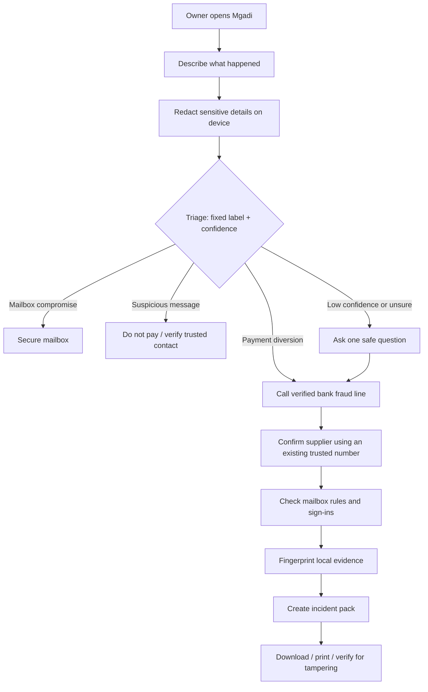
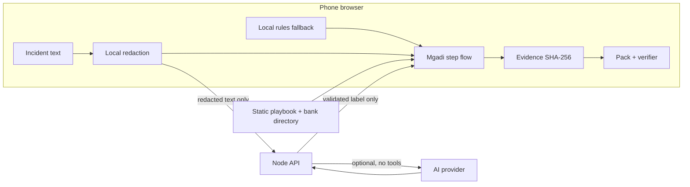

# Mgadi — Source of Truth

**Status:** active build document
**Last updated:** 2026-10-28 SAST (UTC+02:00), POPIA draft / supplier payment-change check / responder handoff branch (`feature/popia-supplier-check-handoff`, stacked on `feature/emergency-offline-readiness`)
**Owners:** Chuma (product, security, server, pitch) and Dalindyebo (mobile experience, browser features, integration)
**Audience:** team members and any AI agent working in this repository

> **Repository state (28 October 2026).** Chuma merged PR #2, PR #3 and PR #6 on 27 October at about 23:06 UTC (01:06 SAST on 28 October): `main` now holds the whole stack through commit `6bda84f`, which includes the supplier-check, POPIA and handoff code. Sentences in this file and in the handover sections below that say "not merged" describe the time they were written. The documentation updates in this file came after that merge, in PR #7. Nothing is deployed.

> Read this file before changing code, product scope, dependencies, data or deployment. Update the change log at the bottom in the same work session whenever a material decision or code change is made.

---

## 1. What we are building

**Mgadi** is a no-install, phone-first web app for a South African small-business owner during the **first hour after a suspected payment-diversion scam**.

A common scenario: a criminal uses a fake invoice or compromised email to say that a supplier's banking details changed. The owner pays the new account, then discovers the real supplier did not receive the money. Mgadi gives the owner reviewed, calm, time-sensitive steps—not improvised AI advice.

### Product promise

> “When a supplier's banking details may have been changed and money has moved, Mgadi gets a small business to the safest first action quickly, protects their privacy, and helps preserve a usable incident record.”

### The narrow MVP

The primary incident is **payment diversion / business email compromise**. We support a few nearby classifications only to safely route someone who does not use technical words:

| Label | Meaning | Where it goes |
|---|---|---|
| `payment_diversion` | Money moved after changed banking details, a fake invoice, or similar deception | Emergency response playbook |
| `mailbox_compromise` | A business email account may be accessed by someone else | Mailbox protection steps |
| `suspicious_message` | Suspicious request, but no money moved yet | Stop-and-verify steps |
| `not_cyber` | Ordinary payment/admin problem | Cautious double-check guidance |
| `unsure` | Not enough reliable detail | Bank-first caution route, reached through a one-question clarification (built on `feature/critical-fixes`) |
| `ransomware_suspected` | Files or a device are locked or encrypted, or someone demands money to unlock them or threatens to leak data | Seven-step ransomware first-steps guide. **Draft (`reviewed: false`)**: written from public CISA, No More Ransom and NIST IR 8374 Rev.1 material; no practitioner has reviewed it. Added in the emergency-readiness sprint (branch `feature/emergency-offline-readiness`); Chuma to confirm the product decision |

### Explicitly out of scope for this MVP

- Accounts, logins, subscriptions and cloud evidence storage.
- WhatsApp integrations, mailbox monitoring or automatic email access.
- Sending an AI to negotiate with a bank, supplier or criminal.
- Legal determinations, fraud investigations or guarantees of recovery.
- Handling real bank credentials, OTPs, passwords, PINs or card numbers.
- Unrequested automated calls. User-requested calls to the person reporting are now approved product scope; provider setup, consent handling and deployment remain implementation work (see §8 and §11).

> **Scope note (28 October).** The supplier check and the responder handoff (§3) are the first features where Mgadi's server keeps anything for a person: **locked (encrypted) content that it cannot read, a status and times, for at most 7 days, with no account**. That is not accounts and not evidence storage (evidence still never leaves the device), but it is a change from "the server keeps nothing". `LINKS-DATA.md` states exactly what is kept. The team has not yet confirmed this as part of the agreed scope: see proposed invariants 18–23 in §5.

---

## 2. Full user flow



### Entry and the ransomware route (branch `feature/emergency-offline-readiness`)

The first screen now offers **five plain-language choices** beside the free-text box, so nobody has to name an attack: money or a payment problem, my device or files are locked, someone accessed my email or account, a suspicious message or link, I don't know what happened. "Money" asks one second question and then goes to the payment guide, or the bank-first caution route. "Locked files" goes to the ransomware guide. A story that mixes a payment problem with locked files is **never** sent only to the ransomware guide: it asks one question so the bank step is not lost. Ransomware rules never ask whether a payment was made and never advise paying or replying. The bank button stays in the header on every screen.

### Supplier payment-change check, POPIA draft and helper handoff (branch `feature/popia-supplier-check-handoff`)

Three additions that sit **beside** the emergency flow and never replace it (the five emergency choices and the always-visible bank button are unchanged).

1. **Supplier payment-change check (before paying).** A separate button under the five choices. The owner logs a request that changed a supplier's banking details; Mgadi lists red flags (changed banking details, how it arrived, pressure/secrecy, a new account name and so on) and says **VERIFY BEFORE PAYING**. The owner records an **independent verification**: who they spoke to, whether the number came from something they already held before the request (a number taken from the request itself does not count), and the answer. They may then make a link for a **second person**, who opens it with no account and **approves or rejects once**. The owner's page shows the answer with the server's time. The owner can make an **audit record** (a JSON file with a SHA-256 fingerprint) and download it. **Mgadi never blocks, holds or releases a payment and never says it does.** "I have already paid" goes straight to the existing bank-first guide.
2. **POPIA notification draft.** On the incident-pack screen. A template for the responsible party's **information officer**, built in the browser from the pack: what Mgadi knows, blanks for what it does not, the section 22 trigger question left as a decision for the information officer, and the Regulator's form/channel to be checked. It is **not legal advice**, says so first and last, never states that a breach happened, and sends nothing to any server. Downloadable as text.
3. **Responder handoff.** On the incident-pack screen. A short summary (smaller than the pack: no story, business name, amount or evidence names/fingerprints) is shown to the owner for approval, then shared by link. The contact opens it and presses **Acknowledge** (statuses: draft, sent, acknowledged). Acknowledged means "seen", never "accepted"; Mgadi cannot tell whether a link was delivered or opened until the contact presses the button.

All of it is untrusted-input safe: whatever comes out of a link is validated, cleaned and shown as text only, and no number or link in it is ever made clickable.

### Payment-diversion journey in detail

1. Owner opens Mgadi—no login, no installation.
2. Owner describes the incident and may provide names to hide.
3. Browser redacts names, links, emails, amounts, phone numbers and long account-like numbers.
4. Mgadi classifies only the redacted text into the fixed label list. A local rules fallback works if AI, internet or the server fails.
5. The **bank fraud-line action is always visible first**. The owner chooses a bank and uses an official `tel:` link; Mgadi never calls a number copied from the scam.
6. Owner confirms the supplier by calling a pre-existing trusted number—not by replying to the suspicious message.
7. Owner checks mailbox rules, forwarding and unfamiliar sign-ins.
8. Owner selects evidence files; their SHA-256 fingerprints are made locally. Evidence file contents are not uploaded.
9. Mgadi creates a downloadable, printable incident pack containing timeline and evidence fingerprints. Bank reference and structured outcomes are approved additions, not implemented fields yet.
10. A verifier can show whether a later copy of the pack was changed.

---

## 3. Feature inventory and status

| Feature | Status | Files / notes |
|---|---|---|
| Mobile incident form | Built | `public/index.html`, `public/app.js`, `public/styles.css` |
| Local redaction | Built | `public/shared/redact.js`; browser then server redaction |
| Fixed-label rules triage | Built | `public/shared/labels.js`, `public/shared/rules.js` |
| Protected triage API | Built | `server/app.js` |
| Optional AI adapter | Built, disabled unless key provided | `server/ai.js`; requires `.env.local` |
| Rules fallback | Built | Used for AI outage and demo without API access |
| Bank directory and tap-to-call | Built | `public/data/fraud-lines.json`; phone-check before judging |
| Guided response screens | Built | `public/data/playbook.json`, `public/app.js` |
| Local evidence fingerprinting | Built for HTTPS/localhost | `public/shared/sha256.js`; see known limitation below |
| Incident pack / JSON download / print | Built | `public/shared/pack.js`, `public/app.js` |
| Tamper verifier | Built | `public/shared/pack.js`, `public/app.js` |
| Scoreboard | Built | `scripts/scoreboard.js` |
| Triage timeout and skip | Built (branch `feature/critical-fixes`) | `public/shared/triage-client.js`: 5 s limit, validated response, local rules on any failure, "Use the guide on this phone now" button |
| Clarifying question for unclear cases | Built (branch) | `playbook.json` `clarify`; owner's answer picks a reviewed route. Free-text intake still English-first |
| Privacy-first pack preview and readable summary | Built (branch) | `public/shared/summary.js`, `app.js`. Masked story by default; original words, business name and amount are the owner's choice. Pack format is now `mgadi-incident-pack/3` (see the handoff row); older `/2` packs still verify |
| Visible draft status and bank-directory date | Built (branch) | `reviewBadge()` in `app.js`; driven by `playbook.reviewed` |
| Browser voice conversation ("Talk to Mgadi") | Built on `feature/live-voice-companion`; **never run against a real Retell account** | Retell v3 SDK, server-side authorization, consent, live captions, states, mute/end. See `VOICE-COMPANION.md`. Off by default (`MGADI_VOICE_MODE`) |
| Floating 3D avatar during voice | Built (same branch) | Idle/listening/speaking poses on the original avatar; larger/smaller/hide; reduced motion; steps aside at 150%+ text on narrow screens. A visual companion, not a SASL translator |
| Reviewed-SASL video player | Built, **no clip exists** | `public/accessibility/signs.js` requires reviewer, date, rights, captions; registry is empty |
| Voice by language | English yes (once configured and verified); Afrikaans blocked until its guide strings are all translated; isiZulu and isiXhosa never (Retell lists no support) | `server/voice.js` |
| Symptom-first entry (five plain choices) | Built (branch) | `public/data/playbook.json` `entry`, `app.js`; `scripts/emergency-smoke.mjs` |
| Ransomware guide | Built (branch), **draft, unreviewed** | `ransomware_suspected` in `labels.js`/`rules.js`/`ai.js`/`playbook.json`; resources in `public/data/resources.json` (reviewed host allowlist, https only, outside Mgadi). Rules scored on a sealed set once: see limitation 10 |
| Incident-pack handoff (pack format /3) | Built (branch) | `public/shared/summary.js`, `app.js`. Optional, collapsed form; what the owner typed is bounded and masked, taps are worded "reported by the owner (a tap)", never "completed"; ransomware gets a specialist summary; no referral is claimed |
| Operator test gate and shared quota layer for voice | Built (branch); **never run against a real Retell account** | `server/voice.js`, `server/quota.js`, `VOICE-REAL-TEST.md`. Token only over https or the same machine; public voice refused on Vercel without a shared store |
| Accessibility audit (automated) | Built (branch). **Not a WCAG claim** | `scripts/a11y-smoke.mjs`: axe, keyboard order, focus, target sizes, language honesty, SASL gate. No real assistive-technology testing |
| Translation coverage report | Built (branch) | `scripts/translation-coverage.mjs` generates `TRANSLATION-COVERAGE.md`; a test fails if it is stale. Coverage is partial and every draft is unreviewed |
| CI workflow | Written and its steps run locally, but **NOT ACTIVE and never run on GitHub**: the connection used to publish this branch was refused permission to write under `.github/workflows/` | `entry/ci/github-actions-ci.yml` (copy it to `.github/workflows/ci.yml` to switch it on): unit, scoreboard, reproducible build, browser suites (a skipped suite fails), audit. No secrets |
| Security self-review | Written (branch). **Not a penetration test** | `SECURITY-REVIEW.md` |
| Real AI evaluation score | Not done | Needs API key and fresh held-out cases |
| Full phone evidence test | Not done | Needs HTTPS because Web Crypto is restricted on HTTP LAN addresses |
| Practitioner review of playbook | Not done | Ask Track 3 mentor; keep draft badge until done |
| Timed user test / demo video | Not done | Recruit 3–5 people; record results honestly |
| Real phone callback to reporter | Approved scope; not implemented; **no longer the primary path** (browser voice replaces it) | Retell AI is the assumed candidate from Chuma's reply; South African routing/account setup unverified. See `VOICE-CALLS.md` |
| Vercel HTTPS deployment | Vercel adapters/config prepared and locally tested. **Nothing has been deployed; no URL exists** | `api/`, `vercel.json`, `DEPLOYMENT.txt`, `RELEASE-READINESS.md` §5. The Vercel build and runtime, HTTPS headers and Deployment Protection are unverified |
| Offline PWA (installable, reopens with no connection) | **Built and tested in desktop Chromium with the HTTP server shut down** (branch). Not tested on any phone | `server/precache.js`, `public/sw.js`, `public/offline/register.js`, `scripts/build.mjs`, `scripts/pwa-smoke.mjs`. Public static files only, saved all-or-nothing and hash-checked; no runtime caching; needs HTTPS or localhost and one completed online visit; the browser can still evict it |
| Elapsed time / outcomes / bank reference | **Partly built (branch):** an optional reference number the owner types (never generated; account-like numbers refused) and an outcome (unknown / pending / told) are in the pack handoff. Elapsed time, recall-requested and recovered-amount fields are **not** built | Existing timestamps cannot establish faster help or recovery |
| Redaction preview / readable pack / privacy demo view | Readable summary and pack sharing preview built (branch). Redaction preview before sending and the privacy demo view are not implemented | See §11 and `REVIEW-AND-TEST-CHECKLIST.md` |
| Language choice / translated interview / accessible assistance | Language choice and draft text in 4 languages built; voice per language as above; translated interview and SASL content not built | All requested text languages are a coverage goal; release per reviewed language. SASL needs distinct content |
| Default referrals / preferred contacts / task tracking | Approved; not implemented beyond the pack handoff, which lists the owner's tapped steps and states **"No referral was made"** | No registration prerequisite; referral is not accepted dispatch |
| Sealed links (the only new server-side state) | Built (branch `feature/popia-supplier-check-handoff`); tested against a memory store and a **fake** shared store, **never a real one** | `server/links.js`, `api/links.js`, route `POST /api/links` in `server/app.js`, `public/shared/seal.js`. Content is locked in the browser (AES-GCM); the key lives only after the `#` in the link. The server keeps ciphertext, two hashed codes, a status and times for **7 days** (1 h to 7 d). Exactly what is kept: `LINKS-DATA.md`. Refuses on Vercel without a shared store |
| Supplier payment-change check | Built (branch). Red-flag wording and the verification questions are **unreviewed by any practitioner** | `public/shared/supplier-check.js`, `public/tools/tools.js`. Second person approves/rejects once by link with no account; the first answer wins; replay is harmless; audit record with SHA-256 (checksum, not a signature) built and downloaded in the browser. Never blocks a payment. Wording guard test (`test/supplier-check.test.js`) |
| POPIA notification draft | Built (branch). **Template only; no lawyer or information officer has reviewed it** | `public/shared/popia.js`. Sources read 27–28 Oct 2026 (including the Regulator's own eServices portal guide) are listed at the top of that file and in `PLAYBOOK-REVIEW.md`. Sends nothing anywhere |
| Responder handoff by link | Built (branch). Delivery is **not** built: the owner shares the link themselves | `public/shared/responder.js`, `public/tools/tools.js`. Owner approves a preview; statuses draft/sent/acknowledged; acknowledgement only by the contact's own link; never "accepted" |
| Browser suite for the three tools | Built (branch) | `scripts/tools-smoke.mjs` (two separate browser contexts play the owner and the second person), run by `npm run test:browser`; the accessibility suite also covers the new screens |

### Known limitations to say plainly

1. The current pack is a **checksum**, not a digital signature. It detects accidental or unsophisticated edits; a determined editor can change content and calculate a new checksum.
2. SHA-256 browser fingerprinting works on `localhost` and HTTPS. A phone visiting `http://<laptop-ip>:3000` may not have Web Crypto. Deploy HTTPS or add a tested pure-JavaScript fallback before claiming full phone evidence support.
3. Fraud-line entries were checked online on 2026-10-26; phone-check them before a live demo.
4. Playbook wording is a draft until a practitioner reviews it.
5. AI triage is optional and must be tested against a fresh held-out set; never claim performance not measured by the team.
6. Local rules run when an API request fails or takes longer than 5 seconds. **Offline reopening now exists** (service worker, branch `feature/emergency-offline-readiness`) and is tested in desktop Chromium with the server shut down. It has **not** been tested on a phone, needs HTTPS or localhost and one completed online visit, and the browser can evict the copy. Do not say "works offline on phones" until it has been checked on one.
7. ~~Bank-directory Back returns home~~ Fixed on `feature/accessibility`; on `feature/critical-fixes` a triage result that arrives while the bank directory is open now waits until the owner presses Back.
8. Redaction is pattern based; names are hidden only when supplied in the optional names field. It is not guaranteed anonymisation. The pack now holds the masked description by default; the original words, business name and amount are opt-in after a preview (built on `feature/critical-fixes`).
9. The draft status is now rendered on guidance, clarify and summary screens (from `playbook.reviewed`). It is still a draft: do not describe the guide or any translation as practitioner-reviewed.
10. Rules accuracy: 100% on the sets the rules were written against is a regression guard only. `prep/heldout-3.json` scored 9/17 with 0 unsafe misses, then was **reopened** (a PIN-request fix was made after reading one case); every miss but one goes to the clarifying question. `prep/heldout-4.json` (46 synthetic cases, SHA-256 recorded in `prep/SEALED.json`, committed before any ransomware rule) first scored 46/46 before any change was made in response to it (later runs are regression checks; no rule has been tuned on it), with no unsafe routing, **but the same author wrote the rules and the set and had seen it**, so this is not evidence of real-world accuracy. Free text in isiZulu, isiXhosa and Afrikaans is not verified.
11. Redaction preview before sending is still not built. The pack now defaults to the masked story, but masking is pattern based and names are only hidden when listed.
13. Voice: **no real Retell call has been tested.** The transcript stream needs a Retell public key whose permission to open the monitor socket is unverified; the SDK does not report that failure (the app detects it and shows "Live captions unavailable"). Consent wording, playbook and translations are unreviewed. Public voice is refused on Vercel unless a shared quota store is configured; without one, limits are per instance. An operator test path exists (capped, labelled, https or same machine only) and has only been exercised against fakes. The assistant has not been tested with adversarial speech. See `VOICE-COMPANION.md`, `VOICE-REAL-TEST.md`, `SECURITY-REVIEW.md`.
12. Translations: only the payment-diversion route is substantially drafted in isiZulu, isiXhosa and Afrikaans; the entry screen is about 28% covered, and the ransomware guide, errors and handoff are 0%, so they fall back to English (marked `lang="en"`). See `TRANSLATION-COVERAGE.md`. All of it is unreviewed.
14. The ransomware guide is a draft from public sources. No practitioner has reviewed it, and South African reporting and POPIA wording (SAPS, Information Regulator) in it is unreviewed.
15. The pack handoff records what the owner **tapped and typed**. A tap is "reported by the owner", never proof an action happened or worked; showing a contact is never a referral. Masking is pattern based: a value typed straight after PIN/OTP/password/CVV is hidden, but a secret written another way is missed, and the reference-number field is deliberately not masked (account-like numbers are refused as a heuristic).
16. Accessibility: automated checks only (axe, keyboard, target size, language honesty). No real screen reader, TalkBack/VoiceOver or user testing. The SASL registry is empty, so there is no signing content. This is not a WCAG conformance claim.
17. CI is **not active**: the workflow could not be published to `.github/workflows/` (no permission), so it sits at `entry/ci/github-actions-ci.yml` and has never run on GitHub. Its steps were run locally. Browser suites use desktop Chromium only.
18. Security: self-review only (`SECURITY-REVIEW.md`); no penetration test. Integrity of the offline copy is consistency, not authenticity. COOP was tried and deliberately left out (it hid `navigator.onLine` from the offline test).
19. **Links have no identity.** No accounts, so the server can show that *someone holding the link* pressed Approve or Acknowledge, not who. A link can be forwarded, the channel carrying it can read it, and the address stays in browser history. The typed name is only text. See `LINKS-DATA.md` §6 and §8.
20. **Locked in the browser is not locked against a bad server.** A compromised Mgadi server could serve a changed page that leaks the key. It only protects against a server that merely stores. Same limit as limitation 18 (integrity is not authenticity).
21. **The shared link store has never been used for real.** On a hosted site links need an Upstash-style store (a separate account the owner would create; Mgadi has none). Without it, Vercel refuses links. The code is tested only against a fake. Rate limits are per instance. The server keeps nothing for longer than 7 days, and there is no "delete now".
22. **The supplier check does not prove a supplier is genuine** and is not a payment control. The verification is the owner's report of a call that Mgadi cannot check; the second person's approval is a button press by someone holding a link. The audit record is a checksum, not a signature, and Mgadi keeps no copy. Red-flag and verification wording is a draft that no practitioner has reviewed.
23. **The POPIA draft is a template.** Whether section 22 applies is for the information officer or a lawyer. The Regulator's own guide (read 28 Oct 2026) describes reporting on its eServices portal, with the organisation and its information officers registered first; older law-firm sources describe an emailed form (SCN1). The draft follows both structures and tells the information officer to confirm which route applies today. Nothing in it was reviewed by a South African lawyer. English only: of the 195 sentence-like strings the coverage report finds in the new screens and the texts they build, 3 (2%) have a draft translation, all unreviewed (`TRANSLATION-COVERAGE.md`; text assembled at run time counts as untranslated).
24. The responder handoff has **no delivery**: Mgadi sends no email, SMS or notification. "Sent" means a link was made. "Acknowledged" means the contact pressed a button, not that they accepted any work.

---

## 4. Architecture



### Storage model

| Location | What may exist | What must not exist |
|---|---|---|
| Browser session | Incident state, timeline, redacted text, fingerprints and generated pack | Uploaded evidence files after the owner closes the tab; credentials |
| Node server memory | Rate-limit counters (bounded) and temporary hash-keyed triage cache; voice quota counters keyed by hashed visitor id (or in a shared store if configured) | Raw incident logs, analytics, evidence files, secrets in output |
| Browser memory only | Typed handoff fields, the open voice conversation and its transcript | Anything written to localStorage, sessionStorage, IndexedDB or a cookie (none is used) |
| **Link store (server), new** | Per link, for at most 7 days: locked content (ciphertext), two SHA-256 fingerprints of link codes, a kind, a status, server times, and an optional locked note. In server memory locally, or in an Upstash-style store over https if configured | Plaintext, the key, a raw code, names, amounts, evidence, an audit record, a log. Checked by reading the physical store in tests (`test/links.test.js`) and by capturing the requests of a real browser (`scripts/tools-smoke.mjs`). See `LINKS-DATA.md` |
| Service-worker cache | Public static files only: the app, the playbook, the bank directory, reviewed language data, icons | Any typed text, API reply, voice session, evidence, pack or key. No runtime caching. Checked by listing every cache and storage after a full journey |
| Voice provider (Retell), when voice is on | Audio during the call; the agent is configured not to store transcripts or recordings | Anything the owner has not agreed to on the consent screen. Retention at the provider is verified by a manual dashboard check, not by the app |
| AI provider, if enabled | Redacted incident text for one classification | Raw evidence, names, accounts, passwords, phone numbers, invented advice |
| Git repository | Code, synthetic test data, reviewed public guidance | API keys, real victim data, recordings, real call numbers beyond public official support lines |

---

## 5. MUST NEVER CHANGE without explicit team agreement

These are the product's safety invariants. An AI or developer must not remove, weaken or bypass them to make a demo quicker.

1. **The bank action is immediate.** A clearly visible bank-fraud-line option exists from the first screen and never waits for AI, network or a server response.
2. **No credential collection.** Mgadi never asks for a password, OTP, PIN, card number, full bank account login, remote access or app installation.
3. **No attacker-controlled numbers or links.** Official bank actions come only from reviewed local data, never from a pasted incident. Chuma has approved separate manually entered preferred supplier/IT/insurer contacts: label them user-provided, ask the owner to confirm they were independently known before the incident, and never let them replace the official bank directory or become automatic AI dial targets.
4. **Redact before AI.** Only redacted incident text can be sent to the API or an AI provider. Evidence files never go to AI.
5. **AI cannot invent response advice.** Triage AI returns only validated `{ label, confidence }`. Approved voice guidance may read reviewed steps and ask constrained interview questions; it must not improvise instructions, invent contacts, collect credentials or mark real-world tasks complete without confirmation. Validate action events separately from triage.
6. **Fallback must remain.** If AI, API, Wi-Fi, quota or provider fails, the local rules route must still work.
7. **No unsafe HTML.** User-provided text must be displayed with DOM text nodes / `textContent`; never inject it using `innerHTML`.
8. **Evidence stays local.** File bytes must not be uploaded to Mgadi's server or provider for the MVP.
9. **Be honest about hashing.** A match means “unchanged since captured on this device”; it does not prove a file or pack is genuine.
10. **Use synthetic data only.** Do not test with real victims, real inboxes, real bank systems or private business files without clear authorisation.
11. **No secrets in Git.** API keys exist only in ignored `.env.local` files and must never appear in commits, issues, logs or screenshots.
12. **Do not claim legal advice.** POPIA and reporting content remains informational and tells the user to seek qualified help.
13. **Callbacks are user-requested.** Chuma chose real calls to the person reporting. Each call needs the user's affirmative request, an authorised number, provider setup, named operational owner, cost limits and reviewed script. Record action events by default; audio/transcript retention is a separate choice. No automatic calls to banks, suppliers, interpreters or cyber responders.

---

### Proposed additions from the emergency-readiness sprint (NEED TEAM CONFIRMATION; not yet part of the agreed list)

14. The offline copy holds public static files only. No runtime caching of typed text, API replies, voice sessions, evidence or packs.
15. A tap is the owner's report. The pack and handoff say "reported by the owner", never "completed", and never imply a referral was accepted.
16. Operator test access never makes a language public, never bypasses the privacy and translation checks, and its token is honoured only over https or the same machine.
17. Ransomware guidance never asks whether a payment was made, never tells the owner to pay or reply, and a mixed payment-and-locked-files story always keeps the bank step.

### Proposed additions from the POPIA / supplier-check / handoff sprint (NEED TEAM CONFIRMATION; not yet part of the agreed list)

18. **Mgadi never blocks, holds, releases or vouches for a payment or a supplier, and never implies it does.** A pattern test over every new screen string enforces the wording (`test/supplier-check.test.js`); it is a safety net, not proof, so a human must still read new copy.
19. **The link service keeps only locked content and the fields listed in `LINKS-DATA.md`, for at most 7 days.** No plaintext, key, raw code, account, address or log may be added without updating that file and agreeing it.
20. **A status changes only when the server records an action by someone holding the right link.** Nothing is assumed: not delivery, not opening, not acceptance. The first valid answer stands and cannot be changed or replayed into a different answer.
21. **Everything that arrives through a link is untrusted:** validated against a strict shape, cleaned, cut to length, set as text only, with no number or link made clickable.
22. **The POPIA draft never asserts a breach or a legal duty** and always carries the "template, not legal advice" notice first and last. The decision stays with the information officer.
23. **The responder summary is smaller than the pack** (no story, business name, amount or evidence names/fingerprints) and is shown to the owner for approval before anything is shared.

## 6. CAN CHANGE freely

The team may improve these as long as the safety invariants stay intact:

- Visual design, copy, language, branding, animation and screen order.
- The exact local rules and confidence values, using fresh tests and general patterns—not one copied test sentence.
- Playbook wording after mentor/practitioner feedback.
- The set of supported banks, after verifying official numbers and dates.
- AI provider/model, as long as its API key stays server-side and its output is limited/validated.
- Deployment platform and framework, as long as no evidence/credentials become stored unexpectedly.
- Extra accessibility, translation and onboarding features.
- Pack layout and print design; preserve the truthfulness of fingerprints.
- New features that do not expand scope into unsafe automation or data collection.

---

## 7. Team and AI work protocol

### Before any change

1. Read this file and `AGENTS.md` in the repository root.
2. Check `git status`; do not overwrite another person's uncommitted work.
3. State the intended change and files before editing.
4. Check whether it touches a MUST NEVER CHANGE invariant.
5. Make the smallest coherent change and test it.

### After any material change

1. Run `npm.cmd test` in `entry/`.
2. Run `npm.cmd run scoreboard` after triage/rule changes.
3. Test the changed user path in the browser.
4. Add a row to the change log below: time, owner/AI, files, change, test result and decision.
5. Do not commit or push secrets. Do not push to a remote unless Chuma explicitly asks.

### File ownership during a busy build

| Area | Primary owner | Files |
|---|---|---|
| Product decisions, triage, server, security, pitch | Chuma | `server/`, `public/shared/labels.js`, `redact.js`, `rules.js`, tests, this document |
| Mobile flow, styling, evidence/pack UI | Dalindyebo | `public/app.js`, `public/styles.css`, `public/index.html`, browser UI helpers |
| Shared data/content | Both—coordinate first | `public/data/`, `VOICE-CALLS.md`, this document |

If both people or AIs need the same file, coordinate first and make one focused change at a time.

---

## 8. AI and voice-call decisions

### Triage AI

- **Current mode:** safe local rules fallback.
- **Optional mode:** `server/ai.js` calls a provider only if `ANTHROPIC_API_KEY` exists in `.env.local` and `MGADI_AI` is not `off`.
- **Required before enabling demo AI:** put the key in `.env.local`, restart, run the full flow, test hostile text and run a fresh held-out test set.
- **Never expose:** key, raw incident content, evidence file contents or free-text AI advice.

### Voice calls

Chuma chose a **real phone callback to the person reporting** on 27 October. His suggested “resell” is interpreted as **Retell AI**, pending correction. This authorises planning and implementation of the callback path; it does not create a funded account or configured telephone route.

| Option | Decision |
|---|---|
| Owner taps official bank number using `tel:` | **Built; safe MVP** |
| Owner requests an opt-in AI callback | **Approved next feature**, not live; Retell AI candidate |
| Text interview / voice / SASL help selection | Approved target; expose only working channels as available |
| Human referrals and preferred contacts | Approved target; no prior registration required |
| AI calls bank/supplier/criminal | Out of scope for the hackathon; high risk |

Retell's current managed-number international destination table does not list South Africa. Verify a supported route (potentially imported/custom telephony) before claiming +27 calls work. Language availability depends on speech recognition and the chosen voice; test each exposed language. See official links/readiness checks in `VOICE-CALLS.md`.

**Decision (27 October, evening): the primary voice experience is a browser conversation ("Talk to Mgadi") with a Retell agent, not a telephone callback.** The callback stays an approved stretch only. The conversation reads the same reviewed playbook; the assistant cannot mark steps done, call anyone or give numbers.

The callback follows the same reviewed playbook as text. Reporting alone does not trigger a call. Offer text, requested callback and working sign-language assistance after initial triage without delaying bank action. Switching mode preserves one incident and task state.

Voice changes the privacy boundary: the provider receives the authorised destination number and processes audio. Explain this at callback choice; do not apply the text-only “redacted text leaves the device” claim to voice. Evidence remains local. A short-lived access-controlled browser token and minimal server-side call/task state are needed to sync webhook events. This is not cloud evidence storage or an account requirement. Set retention/deletion and provider storage controls before activation.

---

## 9. Commands and review checklist

From `build/entry`:

```powershell
npm.cmd start
npm.cmd test
npm.cmd run scoreboard
npm.cmd run build          # engine bundle, icons and the offline manifest (needed for the offline copy)
npm.cmd run test:browser   # every browser suite; needs Playwright and axe-core installed outside the lock file
```

### Review script

1. Start the app and open `http://localhost:3000`.
2. Enter: “We paid a supplier after an email said their banking details changed, but they say they never got the money.”
3. Confirm the app shows the bank action immediately.
4. Select a bank and confirm the `tel:` link is official local data.
5. Complete supplier, mailbox and evidence steps.
6. Add a synthetic text file as evidence; make and download a pack.
7. Change a value in the downloaded JSON pack; load it in the verifier and confirm “Pack has been changed.”
8. Paste hostile text containing a fake number; confirm Mgadi never displays the pasted number as an action.
9. Record anything confusing in the change log before changing it.

---

## 10. Change log

| Time (SAST) | Owner | Files / area | Change | Verification / decision |
|---|---|---|---|---|
| 2026-10-28 | Claude (lead developer) with Chuma | `server/links.js`, `api/links.js`, `server/app.js` (one route), `public/shared/{seal,text,supplier-check,responder,popia}.js`, `public/tools/tools.js`, `public/app.js` (wiring), `public/styles.css`, `scripts/{tools-smoke,a11y-smoke,run-browser-suites,translation-coverage}.mjs`, new tests, docs (`LINKS-DATA.md`, `SECURITY-REVIEW.md` §10, `RELEASE-READINESS.md` §9, `PLAYBOOK-REVIEW.md`, `REVIEW-AND-TEST-CHECKLIST.md`, `DEPLOYMENT.txt`, `TRANSLATION-COVERAGE.md`) | Branch `feature/popia-supplier-check-handoff` (from `feature/emergency-offline-readiness` a9ec3d5). **Added:** POPIA notification draft template; supplier payment-change check with independent-verification record, second-person approve/reject by link, SHA-256 audit record; responder handoff with owner-approved preview and acknowledge-by-link. New server-side state: sealed links only (`LINKS-DATA.md`). No existing feature rebuilt; the app wiring is a button, two pack buttons and a hash-change handler. | `npm test` **231/231** (175 existing + 56 new). Browser (desktop Chromium, synthetic data, local server, memory store): browser 37/37, emergency 59/59, voice 88/88, real SDK vs mocked provider 37/37, offline 34/34, accessibility **76/76** (49 + 27 for the new screens), new tools suite **63/63** (including four checks with the server shut down); 394 browser checks in all. Mutation checks on the new tests: see `SECURITY-REVIEW.md` §10 (3 test gaps found and closed, including a wording guard that missed "on hold" and "protected"). Three real bugs found by tests and fixed (retry re-sealed with a new IV, memory store never swept, non-string handoff lines). **NOT done:** deployment, any real shared store, any phone or second real device, screen reader, lawyer/information-officer review of the POPIA text, practitioner review of the red flags, translation, link delivery, approver identity. The code reached `main` through PR #6 (merged by Chuma, 27 Oct about 23:06 UTC, before the final documentation commits); the documentation is PR #7. Not deployed. |
| 2026-10-27 (late) | Claude (lead developer) with Chuma | `server/{voice,quota,app,precache}.js`, `public/{sw.js,offline/,voice/,shared/,app.js,accessibility/,data/}`, `scripts/` (build, five browser suites, runner, preflight, translation coverage), `test/`, `ci/github-actions-ci.yml` (not active), `prep/heldout-4.json`, docs (`SECURITY-REVIEW.md`, `RELEASE-READINESS.md`, `VOICE-REAL-TEST.md`, `VOICE-TEST-RESULTS.md`, `TRANSLATION-COVERAGE.md`) | Branch `feature/emergency-offline-readiness` (from `feature/live-voice-companion` 148d189). **A** real-voice readiness: operator test gate, shared quota layer, key out of config, offline voice handling. **B** symptom-first entry and the draft ransomware guide, new sealed evaluation set. **C** installable offline PWA (atomic hash-verified install, rollback, eviction repair, headers kept, no runtime caching). **D** accessibility audit and fixes, honest SASL dialog, translation coverage report, pack handoff (format /3), value hiding after PIN/OTP/password. **E** hostile-transcript hardening, bounded rate limiter, operator token only over https or the same machine, CORP, a CI workflow (written, NOT active: it could not be published to `.github/workflows/`), security review. | `npm test` **175/175**. Browser (desktop Chromium, synthetic data): browser-smoke 37/37, emergency 59/59, voice 88/88, real SDK vs mocked provider 37/37, offline with server stopped 34/34, accessibility 49/49 (no serious or critical axe findings). Scoreboard on unsealed sets full marks, 0 unsafe; `heldout-3` 9/17 (reopened); `heldout-4` first scored 46/46 and never tuned on (author-bias caveat). `npm audit` 0. Build reproducible. Mutation checks on the new tests (see `RELEASE-READINESS.md` §2 for which). **NOT done:** any real Retell call, any phone, any screen reader, any deployment, any CI run on GitHub, practitioner/legal/translator/SASL review, penetration test. COOP tried and rejected (hid `navigator.onLine` from the offline test). Not merged. |
| 2026-10-27 (night) | Claude with Chuma | `server/voice.js`, `server/app.js`, `api/voice/`, `vercel.json`, `public/voice/`, `public/accessibility/{avatar,signs,accessibility}.js`, `public/app.js`, `public/styles.css`, `scripts/`, tests, `VOICE-COMPANION.md` | Branch `feature/live-voice-companion` (from `feature/critical-fixes` 6280f81): Retell v3 browser voice with a server-side proxy (private key never in the browser), consent, enforced `basic_attributes_only`, language gating (no isiZulu/isiXhosa), live captions, states, mute/end, current action and bank button always visible, floating avatar, reviewed-SASL player (empty), tasks, timeline, privacy indicators, shared journey state. Only two header changes: `microphone=(self)` and `connect-src` + `api.retellai.com` (https/wss). | `npm test`: 93/93. Simulation browser checks 78/78. Real SDK against a mocked provider 20/20. **No real provider call, microphone, phone, screen reader or speaker test.** Not merged or deployed. |
| 2026-10-27 (evening) | Claude with Chuma | `entry/public/shared/{rules,redact,triage-client,summary}.js`, `public/app.js`, `public/data/playbook.json`, `public/styles.css`, `public/accessibility/accessibility.js`, `server/app.js`, `scripts/`, tests, `prep/heldout-{2,3}.json`, docs | Branch `feature/critical-fixes`: triage timeout + skip; broader rules (negation, conflict, scam-word guard, more phrasings); redaction of `R70k`/`70k`/`R1.5m`; clarifying question; honest bank "haven't called yet" option; stale text removed; draft status and directory date shown; privacy-first pack preview and readable summary (pack format /2); no repeated "Audio stopped." announcements; no sideways scroll at 320px/200% text; late triage no longer replaces the bank directory; Vercel rate-limit key. | `npm test`: 44/44 (was 13). Browser smoke (Chromium, 390px and 320px, synthetic data): 37/37. Scoreboard: used sets 100% (regression only); sealed set `heldout-3` 9/17, 0 unsafe. Physical phone, screen reader, HTTPS deployment, practitioner and translation review NOT done. Not merged or deployed. |
| 2026-10-27 11:32 | Codex with Chuma | `CLAUDE.md`, `team/`, `presentation/`, `entry/api/`, `entry/vercel.json`, `entry/server/app.js`, `entry/test/deployment.test.js`, deployment/readme/ignore files, `public/index.html` | Prepared the full Claude coordinator/interview handover, shared task board, pitch snapshot and Vercel rules-only Node adapters. Shared request handler preserves local server support; accepts raw and pre-parsed JSON with size checks. Added visible draft footer. Chuma authorised GitHub push and Vercel publication in this conversation. | `npm.cmd test`: 10/10; scoreboard: 7/7 fixed synthetic rules cases. No provider keys added. GitHub network check and Vercel link failed in this session; no live URL or successful push claimed. Actual publication checks and commit status are in `team/handoffs/publish-baseline.txt`. |
| 2026-10-27 10:41 | Codex with Chuma | `SOURCE-OF-TRUTH.md`, `VOICE-CALLS.md`, `PLAYBOOK-REVIEW.md`, `REVIEW-AND-TEST-CHECKLIST.md`, `README.md` | Documented approved Vercel/PWA, timer/outcomes, privacy/pack, multilingual assistance, real reporter callbacks (Retell candidate), SASL and contacts/tasks. Added review source map, reviewer sheet and comparison-test book. Corrected built-versus-planned descriptions. | Documentation only; `npm.cmd test`: 7/7 passed. No public deployment, live calls, translations or practitioner sign-off created. +27 provider route remains unverified. |
| 2026-10-27 09:31 | Codex with Chuma | `entry/` | Created initial runnable MVP: redaction, fixed-label rules, protected API, phone flow, official bank links, evidence fingerprinting, pack, verifier, optional AI adapter and scoreboard. | `npm.cmd test`: 7 passed. `npm.cmd run scoreboard`: 7/7 synthetic cases, 0 unsafe payment-diversion misses. |
| 2026-10-27 09:31 | Codex with Chuma | `SOURCE-OF-TRUTH.md` | Established this as the team and AI coordination document. Feature work paused at Chuma's request before machine restart. | Next worker must read this file first. |
| 2026-10-27 09:55 | Codex with Chuma | `public/styles.css`, `public/index.html`, workspace `pitch/` | Applied shared forest/ivory/amber brand palette, accessible focus and responsive styling, emergency red, completion green and print layout. Created an editable 10-slide main pitch with four hidden appendix slides, speaker notes, presenter handbook, PDF/HTML companions and reusable brand tokens. Pitch uses “The first hour, guided”; draft review and unmeasured outcomes remain explicit. No response logic or safety invariants changed. | `npm.cmd test`: 7 passed; scoreboard: 7/7 fixed synthetic rules cases. Chrome at 390px: masked request, hostile input, bank-first route, local evidence fingerprint, generated pack, original checksum match, edited mismatch and print passed with no page errors or horizontal overflow. Slide companion render: no text overflow. Native PowerPoint automation unavailable in this Windows logon; PDF rendered from the same shapes in Chrome. Physical-phone HTTPS, practitioner review and live AI/held-out evaluations remain pending. |

## 11. Agreed expansion and build order (27 October)

These are approved requirements, **not claims of built features**. This session records the design first, as Chuma offered. The check-off book is `REVIEW-AND-TEST-CHECKLIST.md`; provenance and review instructions are in `PLAYBOOK-REVIEW.md`.

1. **Foundation and Vercel/PWA:** preserve position when opening bank contacts; add triage timeout and visible draft status; prepare Vercel using `entry/` as project root, HTTPS, manifest, icons and versioned service-worker caches for public assets, guides, bank directory and reviewed language bundles. Offline reopening requires a completed online cache visit; no first-ever offline download. Never cache private incidents, callback/API requests or packs. Show guide/directory dates. Installation stays optional. Cache eviction can remove offline readiness.
2. **Time and outcomes:** calm elapsed time, not a one-hour guarantee/deadline. Capture app-open, first guidance, call-link tap, user-confirmed bank contact, recall requested, reference received, pack and follow-up separately. Incident discovery time is user-reported. Outcomes include pending, failed to reach, not applicable, recovered money (amount/date/source) and unknown. Unknown is not zero loss or success.
3. **Privacy and pack:** redaction preview/counts with correction before sending, honest limits; optional bank/reference and supplier/mailbox outcomes; readable one-page print summary alongside JSON/checksum; preview original description and business/contact details before sharing. Evidence stays local. Checksum is not signature.
4. **Inclusive assistance:** text interview first, language and assistance choice, then optional real callback. Text coverage goal: English, Afrikaans, isiZulu, isiXhosa, isiNdebele, siSwati, Sesotho, Setswana, Sepedi, Tshivenda and Xitsonga; release each after safety-copy/comprehension and routing tests. SASL is its own language/content path. Use reviewed SASL clips or an actual interpreter service when available. A 3D signing avatar stays research scope until validated with SASL users/interpreters. Test each voice language with speakers rather than trusting a dropdown.
5. **Contacts and task ownership:** maintained minimum directory by role: bank fraud, SAPS reporting, cyber/IT support, insurer (policy dependent), interpreter service (if arranged). Verify eligibility, hours, languages, cost and scope. Do not promise a universal free 24/7 cyber responder. Ask whether the user already has someone trusted; allow optional manually entered contacts without registration. Official bank actions stay separate. Tasks record owner role, pending/in progress/blocked/done, time, source of confirmation and next action. Preparing a handoff, sending a request and a responder accepting work are separate events. Share user-approved fields only; dispatch needs a willing receiving service.
6. **Brand and demo:** retain forest/ivory/amber palette and existing pitch slogan “The first hour, guided”. Add a recognisable icon/wordmark for browser/PWA. Truthful privacy/mode indicators and presenter view must not reveal victim information or turn local counters into population claims. Verify competition submission requirements separately; logo polish supports usability/recall.
7. **Evidence for impact:** fresh synthetic cases and counterbalanced timed user tests using the checklist. No established usual-help-time or Mgadi speedup exists. Separate time to correct action from bank waiting time and actual loss/recovery. Field follow-up is needed for financial outcomes.

Deployment and callback setup require actual account access, configuration and credits. No public URL, provider purchase, real call, interpreter connection or responder dispatch was created in this documentation session.

### Product claim

Mgadi aims to reduce confusion/delay, support stopping suspicious payments before money moves, contain suspected compromise and preserve a useful handoff. It does not prevent every attack or guarantee recovery. Containment and evidence can still help when recovery is unavailable. Measure correct action and additional harm as well as speed.

## Accessibility branch handover — 27 October 2026

Chuma requested that this branch be pushed so the other developer can build on it. Branch: `feature/accessibility`, based on `a8a00ab`. The newer ChatGPT-hosted welcome-screen source was unavailable; this change extends the checked-in `entry/` baseline.

Implemented: four-locale selection with partial draft translation bundles; DOM-preserving text changes; explicit incident-choice routes; text sizing, contrast, reduced motion and text-only controls; browser read-aloud with consent and voice-language matching; guidance transcript/signing dialog; original procedural 3D avatar with neutral animation; clearly labelled call walkthrough. Bank-directory return now restores previous screen/input. Camera/microphone restrictions and triage safety boundaries remain intact.

Not implemented: real callback, speech recognition, arbitrary text-to-SASL, camera sign recognition, reviewed SASL motions/media, full approved translation coverage or production deployment. No paid service, real call or evidence upload was used. Read `docs/ACCESSIBILITY-AND-PLAYBOOK.md` for the source map, playbook explanation and questions for Chuma/reviewers.

Validation: 13 Node tests passed; JS syntax and diff whitespace checks passed. Browser checks: typed input retained after language switch; bank-directory return preserves the step after another language change; signing model/transcript renders; consent required before read aloud; text-only call walkthrough at 200% text excludes model controls. Physical phone, native screen reader, actual voice playback and SASL/native-speaker review remain unverified. This is not a WCAG conformance claim.

## Emergency and offline readiness handover — 27 October 2026

Branch `feature/emergency-offline-readiness`, stacked on `feature/live-voice-companion` (PR #3), which is stacked on `feature/critical-fixes` (PR #2). Recommended merge order: #2, then #3 (retarget to `main` once #2 is in), then this branch. **Nothing is merged, deployed or pushed to `main`.** Start with `RELEASE-READINESS.md` (status, evidence, what you must decide) and `SECURITY-REVIEW.md` (findings and residual risk), then `VOICE-REAL-TEST.md` for the first approved real call.

Built: symptom-first entry; a draft ransomware guide with trusted resources; offline PWA; pack handoff; real-voice readiness code (operator gate, quota layer, preflight); accessibility and translation-coverage tooling; a CI workflow (written, not active); security hardening.

Not done, and not claimed: any real Retell call (the empty template is `VOICE-TEST-RESULTS.md`), deployment, phone testing, assistive-technology testing, practitioner, legal, translator or SASL review, penetration test. CI is written but **not active** (see limitation 17). All guidance remains a draft.

## POPIA draft, supplier check and handoff handover — 28 October 2026

Branch `feature/popia-supplier-check-handoff`, stacked on `feature/emergency-offline-readiness` (PR #4, draft), which is stacked on #3 and #2. **The code reached `main` through PR #6 (merged by Chuma, 27 Oct about 23:06 UTC); the final documentation is PR #7. Nothing is deployed.** Start with `LINKS-DATA.md` (exactly what the server keeps and for how long), then `SECURITY-REVIEW.md` §10 (threats, findings, what the tests prove) and `RELEASE-READINESS.md` §9 (built / mocked / not built, what you must decide).

**Built:** the three features above; the link service and its Vercel adapter; unit, HTTP and browser tests (two separate browser contexts play the owner and the second person).

**Mocked or only simulated:** the shared store is exercised against a fake that speaks the Upstash REST protocol; the "second person" and the "contact" are a second browser profile on the same machine, not another device; no message is sent, because Mgadi only makes the link and the owner shares it.

**Not done, and not claimed:** deployment; a real shared store; any phone, second real device or screen reader; a lawyer's or information officer's review of the POPIA text; a practitioner's review of the supplier-check red flags and verification wording; translations of the new screens; link delivery; approver identity checks; a server-signed audit attestation; deleting a link early; a penetration test. CI is still not active (limitation 17).

**Decisions waiting for the team:** confirm proposed invariants 18–23; confirm that server-held locked content (no accounts, 7 days) fits the product scope; choose a shared store before any hosted use; choose who reviews the POPIA and supplier-check wording.

