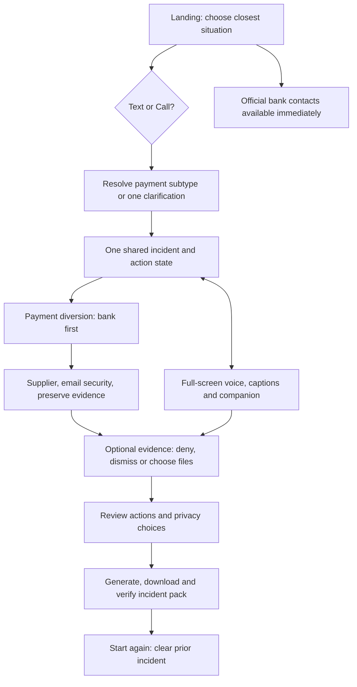
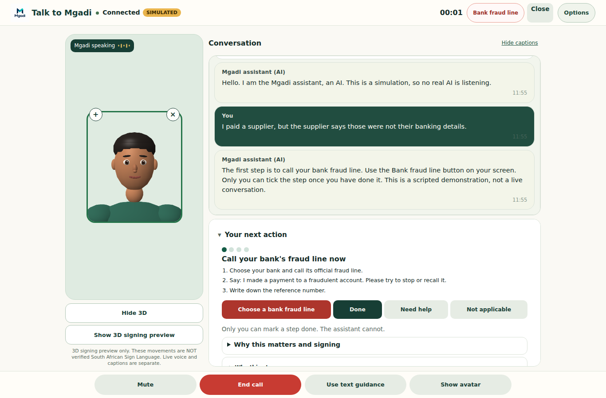
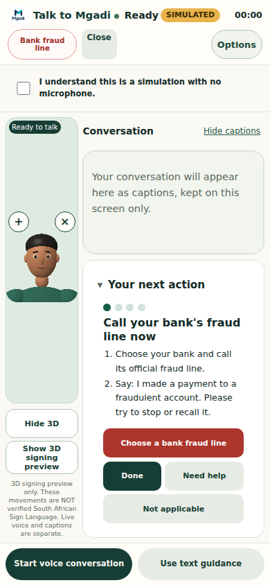

# Mgadi demo journey and release verification

28 October 2026. Application: `entry/`. Branch: `feature/demo-journey-release-readiness`.

This work starts at main `52d10dbc`, incorporates the existing unified call work through `0736f452`, and preserves the logo, forest/cream/gold direction, provider safeguards, incident playbooks and backend. It does not merge main or enable a paid voice provider.

## Demo-flow map

Both modes use the same route, current step, owner-reported statuses, timestamps and evidence. Mentioning an action in captions never completes it. Call selection keeps the selected situation; a payment choice asks which payment problem occurred before opening voice. Unknown incidents get one question and a safe unsure route. Selecting an exact incident avoids redundant triage.

## Screen-by-screen checklist

The checkmarks below describe implemented navigation and regression coverage. They are not a claim of human usability research, screen-reader certification or tested real Retell audio.

| Screen | Arrives from | Controls and next result | Return / mode switch | State and failure behavior |
|---|---|---|---|---|
| ✓ Landing | Initial visit; Start again; header home | Five incident choices; text/call; describe instead; bank directory; collapsible other tools | Chosen incident reveals/scrolls to mode controls | Start again ends call and clears journey, evidence, fields, outcomes and captions. State is in memory in this tab; reload/home navigation clears it. |
| ✓ Text description | Text without a selection; describe instead | Validate nonempty input; redact names/numbers locally; Find my next safe step | Situation shortcut or bank contacts | Empty input has browser validation; input survives language switching. No secrets requested. |
| ✓ Checking | Submitted description | Bounded triage API; immediate local-guide option | Bank popup can remain open while the result arrives | Timeout, invalid response and network failure fall back to local rules. No incident text is logged. |
| ✓ Payment question | Money choice in either mode | Already paid after changed details → payment diversion; not paid → suspicious message; ordinary → ordinary guidance; unsure → clarification | Back → landing | Mode preference carries into the selected guide; no call opens before the question is resolved. |
| ✓ One quick question | Unknown selection or uncertain classification | Five answers lead to existing incident guides, including unsure | Start again; optional voice launcher | The chosen route is recorded accurately in the pack; the owner answer is retained. |
| ✓ Incident response | Direct choice, triage or clarification | One action at a time; Done / Need help / Not applicable; revisit numbered steps; formats; sources | Talk to Mgadi; bank toggle; Start again | Only owner taps update statuses. Bank Done means owner-reported calling, never verified bank action. Need help records a need; it sends no request. |
| ✓ Bank contact directory | Header, current bank action or voice bank button | Official directory from the shipped data; native `tel:` links | Same button toggles closed; explicit close; Escape restores focus | No action is auto-completed and no call is claimed. Checking date is visible. Live telephone calls were not placed. Directory remains over a delayed triage result. |
| ✓ Voice workspace | Call after incident selection; header call; text-step launcher | Consent-gated start; mute/unmute; end; restart captions; independent captions/3D/illustrative-gesture controls; current action; Options | Use text guidance; Close; Escape; direct evidence handoff after final action | Full-screen, keyboard focus contained; Options exposes language/accessibility. Switching modes, ending or closing preserves progress. Start again clears it. Cancellation releases a late provider handle. |
| ✓ Voice setup / failure | Voice opens or provider fails | Simulation badge, consent, availability reason, retry; optional operator setup | Text remains available; bank remains available | Real calls use only configured Retell. No browser speech/Claude experiment silently substitutes. Mock is scripted, no microphone/audio/provider. Unsupported languages explain fallback. |
| ✓ Evidence | Last response action; manual incident-record tool | Dismissible optional permission card; Deny; Accept & choose files; native file input; explanation opens a separate tab | Back to response steps; Review pack; Start a new incident | Deny/dismiss do not block. Files are hashed locally; name/size/type/SHA-256/time recorded, not bytes. Duplicates avoided. Read failure explains retry/continue. Review waits for pending fingerprints. |
| ✓ Evidence access explanation | Optional card link | Plain explanation of selected-file access and exclusions | Close the explanation tab to return to the original incident; home link opens a fresh start in that tab | Original incident remains in its original tab. No broad filesystem permission requested. |
| ✓ Pack review | Evidence review button | Distinct Done / Need help / Not applicable / skipped wording; optional original words, business, amount, handoff, evidence, timeline | Back → evidence retains typed fields, files and options | Original description is opt-in. Evidence/timeline can be excluded because filenames may be sensitive. Generation error retains entries and offers retry or Back. |
| ✓ Incident summary | Successful generation | Completion message; JSON download; Print/save PDF; expandable technical data and tamper check | Start new incident; optional helper, POPIA or document tools | Download bytes match on-screen JSON. SHA-256 verifier detects edits. Completion does not claim submission, bank contact, money recovery or accepted referral. |
| ✓ Supplier pre-payment check | Other tools | Describe changed details; compare old/new details; evaluate; optional encrypted approval link | Back; already-paid escape to bank-first guide | Validation errors explained; not bank identity verification or a payment block. Shared-link service tested against local storage, not certified on preview. |
| ✓ Supplier result / owner / approver | Supplier check or capability link | Owner status/audit; approver own confirmation/rejection with consent | Header home; check flow Back | Expired, malformed and edited links fail closed with recovery. No message is sent automatically. |
| ✓ Document Evidence Assist | Other tools, supplier tool, incident summary | Local PDF/message extraction, comparison, provenance and confirmation | Back returns to originating tool/summary | It cannot prove authenticity or scan a device. It is separate from incident evidence fingerprints. |
| ✓ POPIA draft | Incident summary | Editable draft, copy, text download | Back to incident summary | Template only, no filing or legal decision. Copy failure offers download. |
| ✓ Helper summary / contact / status | Incident summary or capability link | Preview; explicit sharing checkbox; encrypted link creation; recipient acknowledgement | Back to summary; owner status → start | Creates a link for the owner to send. Does not send a message, certify delivery or imply help accepted. Missing store/network/invalid link has clear failure recovery. |
| ✓ Language/accessibility | Global settings; voice Options | Language, text size, contrast, reduced motion, text-only, consented read-aloud | Close settings; voice Options closes independently | English fallback and draft translations disclosed. Unavailable installed speech voice is explained. “SASL availability” shows availability, not a fabricated translation. |
| Separate experiments | Direct `/talkback.html` or `/gesture-demo.html` URL only | Existing standalone experiments retained for code preservation | Their home links return to the incident app | No primary app control routes into a separate experimental conversation. They are not validated SASL or a continuation of incident state. |

## Features and honest capability boundaries

| Feature | Status | Practical limit |
|---|---|---|
| Selected-incident text journey, six incident routes, clarifying choice | Functional locally in browser | Draft playbooks; practitioner review pending. |
| Shared text/voice progress and owner action outcomes | Functional locally in browser | In-memory tab state; no account/server incident persistence. |
| Bank directory toggle and telephone links | Functional controls | Numbers carry a checked date; no phone calls placed in this QA. Verify with card/official app. |
| Voice on inspected live deployment | Browser simulation | `/api/voice/config` returned `mode: mock`, `simulated: true`, English only. Scripted captions, no microphone or real AI audio. |
| Retell session/SDK integration | Implemented; mocked integration tested | Real microphone, two-way provider audio and genuine live transcript/disconnection still require a configured real deployment test. |
| Retell public launch | Configuration/provider gate | Requires server key, agent, verified language/privacy setup and supported quota storage. This task does not enable or claim it. |
| Speaking/listening companion and gestures | Functional renderer and event-driven animation | Simulated events in mock mode; local animation preview is labelled. Illustrative gestures are not validated SASL. |
| SASL translations | Not implemented/reviewed | Shipped reviewed-sign registry is empty. Availability control says so. |
| Optional evidence selection and SHA-256 fingerprints | Functional in browser | Files remain local. Hash is a content checksum, not proof of authenticity, a signature or a malware scan. |
| Review, JSON pack, print and checksum verifier | Functional in browser | Original evidence bytes are separate. Print/save PDF uses the browser print UI. |
| Local offline emergency guide and report creation | Implemented; offline regression suite | Requires a successful prior save; browser can evict the copy. Cloud voice and external links still need internet. |
| AI triage | External provider optional; safe local fallback functional | AI classification is bounded; no paid real-provider triage test performed here. |
| Supplier approval and helper capability links | Functional local integration | Deployment store availability/configuration must be verified separately. No messages sent in this task. |
| Browser readiness indicator | Functional availability check | Explicitly not a malware scan or security certification. |
| Translations / read aloud | Partial drafts / device-dependent | Missing translations stay English; voice and SASL support are not inferred from language selection. |

## Failure and recovery checks

| Condition | Verification / recovery |
|---|---|
| Microphone denied | Simulated permission-error path and controller tests: explain permission settings or switch to text. Actual Retell microphone test remains unverified. |
| Audio unavailable | Read-aloud unavailable/error messaging and Retell sound-unlock hint are implemented. Physical audio playback not certified in this environment. |
| AI silent, slow or unavailable | Triage timeout and immediate local-guide escape tested; failed voice offers retry/text. |
| Internet lost | Browser offline event ends voice, keeps progress/captions and leaves emergency text actions usable. Cached guide/report tested separately. |
| File cannot be read | Browser test injects a read error; recovery asks to reselect or continue, without recording fake evidence. |
| Voice closed during connection | Controller regression releases a late handle and ignores stale events. Close/Escape/mode switch retain incident steps. |
| Unsupported language | Draft/fallback notice, disabled provider start with a reason, no substitution with a different-language voice. |
| Empty incident description | Browser validation; no API call or invented incident. Situation selection remains available. |
| Report generation fails | Browser test injects a digest failure; review stays, button re-enables and retry succeeds. |
| Guide cannot load | Bank-card fraud-line fallback and explicit reload button; unusable directory control disabled. |

## Visual and accessibility findings

Preserved the authentic logo and existing colour direction. Corrected unreadable user captions, low-contrast secondary text, 200% landing/review overflow, split action labels, evidence card overlap, a missing mobile call close control, keyboard inset handling, duplicated progress text and confusing secondary voice engines. The main companion and illustrative gestures have independent visibility controls. Selecting an incident scrolls to the communication choice. Desktop incident choices use two columns to shorten the landing screen.

Screens checked with Chromium include desktop, tablet and phone widths 320, 360, 390, 430, 768, 1024 and 1280/1366; 200% text settings; reduced motion; keyboard focus and Escape; simulated speech/listening states; evidence; review; and summary. Captions and the current action scroll within the full-screen voice workspace when needed; emergency controls remain reachable. Automated axe checks are evidence only, not a WCAG or screen-reader conformance claim. No physical-phone or participant usability study was performed.

## Recommended three-minute demonstration

Use synthetic information and a small synthetic proof-of-payment text file. Inspect the deployment voice mode before presenting.

| Time | Demonstration |
|---|---|
| 0:00–0:25 | Open Mgadi. Say: “A supplier says the banking details I paid were fraudulent.” Choose Money or a payment problem → Call Mgadi → I paid after bank details changed. |
| 0:25–0:50 | Show the full-screen companion. Read the SIMULATED label aloud: “This deployment uses scripted captions; no microphone or real AI audio.” Agree to the simulation and start. Toggle captions or companion once. |
| 0:50–1:20 | Open and close Bank fraud line with the same button. Explain that the owner calls their bank themselves. Choose Need help for the bank in this synthetic example; do not claim a call. |
| 1:20–1:50 | Show the supplier action. Report synthetic outcomes: Done, then Not applicable for the mailbox, then Done for preserving evidence. Explain these are owner-reported statuses, not verified results. Switch to text once if demonstrating shared progress. |
| 1:50–2:15 | Continue to evidence and pack. Show Deny is allowed, or Accept & choose files using the browser picker. Fingerprint a small synthetic file. |
| 2:15–2:45 | Review distinct outcomes and privacy checkboxes. Generate and download JSON. Show the bank is not reported called and that evidence is a fingerprint, not uploaded bytes. |
| 2:45–3:00 | Show the completion state and Start a new incident. Explain local emergency guidance still works if optional AI fails; live Retell and validated SASL are separate release gates. |

## Automated results and deployment

The final run results and preview status are recorded below after verification. A failed or unavailable test is never counted as passed. No merge into main is authorized.

### Latest completed checks

| Command / suite | Actual result |
|---|---|
| `npm test` | 303/303 passed, zero skipped |
| `npm run build` | Passed; Retell bundle, icons and offline manifest generated |
| `browser-smoke` | 37/37 passed |
| `emergency-smoke` | 59/59 passed |
| `voice-smoke` | 87/87 passed, simulation only |
| `retell-sdk-smoke` | 37/37 passed, actual SDK with mocked provider |
| `pwa-smoke` | 34/34 passed, real offline/corrupt-cache/update browser checks |
| `a11y-smoke` | 76/76 passed, including axe and focus tests |
| `tools-smoke` | 63/63 passed |
| `evidence-smoke` | 47/47 passed, including axe |
| `update-smoke` | 19/19 passed |
| `experience-smoke` | 52/52 passed: hero, alternatives, transitions, failures, picker and exact downloaded JSON |
| `voice-avatar-smoke` | 87/87 passed, renderer/layout/simulated events |
| `voice-live-smoke` | 27/35 passed; eight audio/ICE assertions failed in this container |

`npm run test:browser` was executed and does **not** pass as a whole. The complete runs and targeted reruns exposed and fixed stale selectors/expectations; the latest per-suite results are above. Its remaining WebRTC gateway test cannot establish ICE connectivity here (`connectionState: new`), so remote audio levels stay zero. This environment also cannot enumerate network interfaces; the dev server now tolerates that restriction. These observations limit verification; they do not prove that a real deployment's audio works or fails. No real Retell call was made, and no synthetic tone is offered to the user as a substitute.

Environment: Node 24.22.1 in the work container; project/Vercel target is Node 22.x. Chromium 153 headless from the published `@sparticuz/chromium` package, Playwright from the provided runtime, axe-core for browser checks. The standard Playwright Chromium download returned a truncated/non-ZIP payload, so a separate temporary local browser package was used. No runtime browser packages or credentials were added to the app. To reproduce, set `MGADI_PLAYWRIGHT` to an installed Playwright module and `MGADI_AXE` to `axe-core/axe.min.js`, then run the three required npm commands from `entry/`.

### Remaining release gates

1. A READY preview for this branch must be confirmed against its Git commit before it is presented as the new application. Deployment status and the exact URL, or the exact provider refusal, are recorded in the accompanying pull request/release message.
2. Real Retell needs a separate configured-deployment test: microphone grant/denial, genuine two-way speech, captions, muted microphone, provider disconnect and internet loss. The inspected live deployment is explicitly simulation mode.
3. Validated SASL needs reviewed, rights-cleared, captioned signing content. Illustrative gestures do not satisfy this gate.
4. Practitioner review of playbooks, fresh bank-number verification, native-speaker review, physical-phone and screen-reader testing remain pending. No certification is claimed.
5. Shared helper/supplier links require deployment storage/configuration verification. Local integration passing is not proof of a production external service.

The recommended judge demonstration is the functioning, explicitly labelled simulation plus emergency actions, local evidence and downloaded incident pack. A real-AI-voice release is not accepted on this evidence alone. Keep this PR unmerged pending review.

### Screenshots from the changed source

Desktop and mobile voice workspace captures from the local hero regression (simulation badge visible):

## Presenter sketch implemented

The attached handwritten flow adds a second, faster presentation path:

1. Scroll to Describe it instead and type the payment-diversion story.
2. The resolved incident shows an **Answer Mgadi** invitation. In mock mode it explicitly says simulated in-app call, no microphone or real telephone call; answering starts the scripted companion/captions. A real provider still requires its voice consent/setup.
3. Open the bank contact directory during the call. Hang up with End call; calls answered through this invitation return directly to the bank feedback screen.
4. Enter optional bank feedback/reference. Only press Done if reporting that you called. Use **Skip to evidence and incident pack** to leave other actions pending.
5. Evidence assistance offers Deny, Accept & choose files, and the formal access explanation. Deny leaves the manual picker available. Accept also requires choosing files; Mgadi cannot search the device or upload automatically.
6. Review now displays each chosen filename, size, type and complete SHA-256 fingerprint, plus bank feedback and honest pending-action states.
7. Generate and download the checksummed incident pack. Preserve the original evidence separately.

A new `presentation-smoke` browser regression follows this exact sequence, denies assistance, selects a file manually, verifies the visible filename/fingerprint and bank feedback, checks unfinished actions, recomputes the pack SHA-256 and compares the actual download bytes: **13/13 passed**. The preceding complete browser run finished with **11/12 suites passing**; only the restricted-runtime mocked WebRTC audio suite failed, 27/35. The revised presentation flow is separately rerun after these changes.
