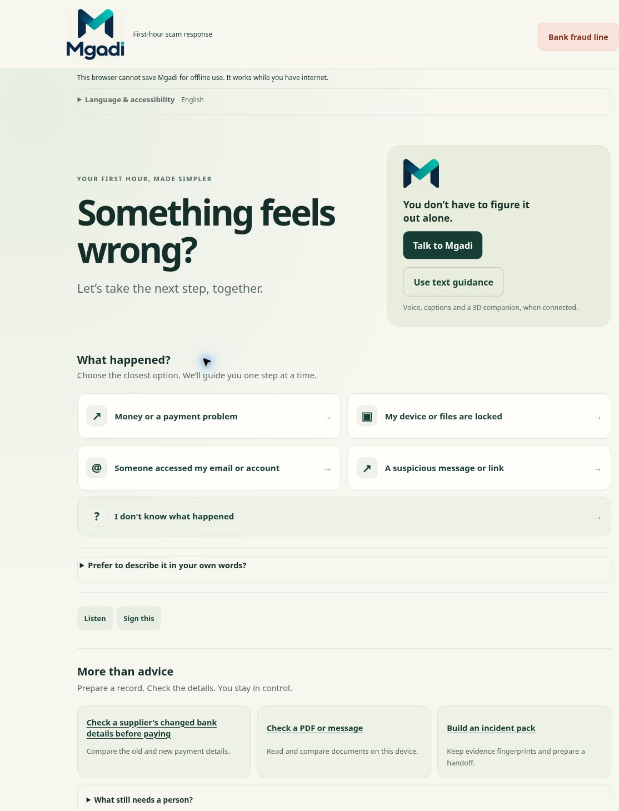

# Mgadi: experience playbook and handoff

28 October 2026. Branch: `feature/ui-experience`, based on `feature/final-demo-integration` at `0113074`. This adds to the latest Claude integration; it does not replace that backend or merge into main.

> **Update (branch `feature/final-mobile-ux`).** The welcome screen described below was redesigned into two doors ("I think something has gone wrong" with the five situations inside it, and "Check before paying"), with calm secondary rows. The supplier check is now three steps. See `UX-REDESIGN.md` and `DESIGN-SYSTEM.md`. The rest of this playbook still describes the guide steps, outcomes and voice panel correctly.

## The journey, in plain language

1. **Welcome:** choose what happened. No typing is required. The bank directory stays in the header. The supplied logo appears in the header and companion card.
2. **One action:** read a short action list. For payment diversion the order is bank → supplier → mailbox → evidence. The other incident routes retain their existing playbooks, including the seven-step ransomware route.
3. **Choose a response:** Done, Need help, or Not applicable. Only the person can report this. The progress buttons let them revisit a step. Correcting a bank step from Done to Need help removes the current bank-called flag; the timeline still records the history.
4. **Choose a format:** read, use device read-aloud, open the signing panel, or use Talk to Mgadi. All live voice entry points share the existing controller and incident state. The duplicate call-walkthrough button was removed.
5. **Keep evidence:** files stay on the device. Review the pack contents before generating or sharing anything. Handoff details are opt-in; when included, the three responses remain distinct. Need help and Not applicable do not become completed actions.

The landing page also exposes working supplier checks, local PDF/message inspection, and direct incident-record creation under **More than advice**. The text/voice choices are explicit. These are preparation and verification tools; they do not execute banking transactions or make calls on the owner’s behalf.

## What changed

- A calm ivory/forest welcome, larger situation cards, clear hierarchy and whitespace, with the user's exact navy/teal logo. The PNG is unchanged; CSS frames out its outer whitespace.
- The optional description form, explanations and review details open only when requested. Critical organisation/IT instructions remain visible on the relevant steps.
- Language settings show the selected language. Added draft isiZulu, isiXhosa and Afrikaans navigation, step-response and some guidance text. English fallback remains explicitly tagged. See the generated `TRANSLATION-COVERAGE.md` for actual coverage, not an assumption of completeness.
- Voice is one panel with captions, consent, controls, an optional current-action disclosure and an integrated avatar. Simulation explicitly says that no microphone is used.
- Original procedural 3D character with lit mesh geometry, separate facial features, hands, breathing and a speaking mouth. Provider activity controls speaking/listening. Animation is limited to roughly 30 frames per second and respects the existing reduced-motion/text-only controls. It is activity animation, **not phoneme lip-sync**.
- Pack generation now reports a visible error on insecure origins instead of silently failing or logging a successful pack that was never generated.

## Design evidence

The choices here apply [GOV.UK's question-page guidance](https://design-system.service.gov.uk/patterns/question-pages/): focus each page on one question, allow uncertainty, and let people revisit answers. The short action blocks and whitespace follow [W3C's cognitive accessibility guidance](https://www.w3.org/WAI/WCAG2/supplemental/objectives/o3-clear-content/). This is a design rationale, not a claim of WCAG certification or user-research validation.

## What is not ready to claim

| Capability | Actual status |
|---|---|
| Text guidance and outcome recording | Implemented; local rules and existing backend retained |
| Four-language interface | Partial draft translations; specialist screens still use English fallback |
| Device read-aloud | Existing implementation; requires consent and an installed matching voice; audible output not verified in this session |
| Speaking/listening 3D companion | Implemented and observed with the labelled voice simulation |
| Real Retell conversation | Existing backend integration retained; no credentials supplied and no paid call made |
| SASL translation or recognition | Not implemented: the reviewed sign registry has no production content. The model must not be demonstrated as translating SASL |
| Production deployment | Not performed in this branch |

## Checks and limits

- Baseline: 257 unit tests passed before changes. Added outcome/pack integrity coverage; final result: 260 passing tests.
- Browser observations: welcome and supplied logo; payment route; Done → revisit → Need help correction; supplier Not applicable; subsequent steps and pack privacy review; simulated captions; avatar speaking/listening; avatar sizing; end-call hiding; direct record creation; local extraction of amount and invoice number from a synthetic pasted message; visible insecure-origin pack errors; 320px frame rendering and isiZulu at 200% text with no horizontal overflow measured.
- The test preview is HTTP. Browser Web Crypto refuses pack hashing there, so the final signed/fingerprinted pack was **not** generated in that browser. Unit tests verify pack generation and the new outcome semantics. Use HTTPS or localhost for the real acceptance test.
- Existing browser smoke scripts have updated selectors for the new disclosures and outcome controls. Their full automated suite was **not rerun** in this session; do not inherit the older 441-check claim for this branch. The browser checks above were performed through the interactive browser.
- No real phone, screen-reader session, native-speaker review, practitioner review, live Retell microphone/audio test or production hosting test is claimed.

## Finish live voice

Follow `VOICE-REAL-TEST.md` and `VOICE-COMPANION.md` in `entry/`. Put private values only in the deployment's secret settings or ignored `.env.local`, never chat or Git.

Required for the English operator test: HTTPS deployment, `RETELL_API_KEY`, domain-restricted `RETELL_PUBLIC_KEY`, `RETELL_AGENT_ID_EN`, published `RETELL_AGENT_VERSION`, and `MGADI_OPERATOR_TOKEN`. Keep `MGADI_VOICE_VERIFIED_LANGUAGES` empty until actual tests pass. Hosted public quotas need the shared store described in `.env.example`.

Agree to one short capped test with synthetic information, then check microphone permission, South African English recognition, audible replies, two-sided captions, avatar states, mute/end, fallback, privacy settings and the actual charge. Text translations alone must not unlock an unsupported spoken language. An existing telephone number is not needed for the browser-call path.

## Review with Mike and the team

- [ ] Confirm the new welcome and logo placement on your phone.
- [ ] Confirm the three owner-response buttons and the ability to correct a response.
- [ ] Identify the HTTPS deployment and configure Retell privately; authorise a capped real test.
- [ ] Ask native speakers to review the draft language text.
- [ ] Supply reviewed SASL animations/clips and reviewer details before calling the model a sign-language translator.
- [ ] Run the full browser suite and real-device accessibility checks before merging/releasing.

Implementation starts in `public/app.js`, presentation in `public/experience.css`, character geometry in `public/accessibility/avatar.js`, and voice presentation in `public/voice/panel.js`. Backend files were not rewritten.
